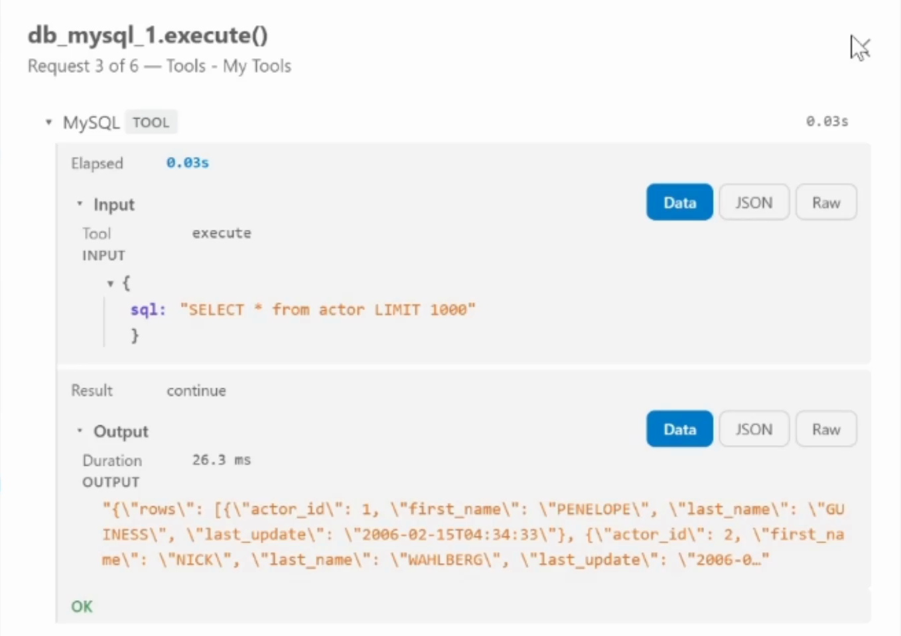

# How Do I Debug an AI Agent Run After It Finished?

Logs show what an agent printed. A recorded run shows what it did, and it can be trusted because replay uses the same code path as live.

By [Mithilesh Gaurihar](https://www.linkedin.com/in/mithilesh-gaurihar/). Last verified: October 2026.

> **Quick Answer.** Debugging an AI agent run after it finished needs a recording of what each step was handed, what it returned and how long it took. RocketRide records every agent pipeline run and replays it in the VS Code extension: play it back at up to 25x, pause, step request by request, and open any tool or model call to read its input. Replay matches live because both use the same client code over the same server-stamped events. Recordings last up to 7 days, or 30 when deployed.
## Why Don't Logs Tell Me What My Agent Did?

Once an agent runs for other people, the questions turn forensic. What did it do in the thirty seconds before yesterday's batch went wrong? Which tool call was slow, and what was it handed?

A log can't answer that. A log line records what a step chose to print. It doesn't record what the step was handed, what it returned, how long it waited, or what else was in flight at the same moment. Rebuilding concurrency from interleaved print lines is archaeology, and it gets worse under load, when more lines arrive from more places at once.

## What Is Agent Run Replay?

Agent run replay is playing back a recording of a finished agent run, call by call, in the order and with the timing it happened, so the run can be inspected without running it again. For a replay to answer the questions a log can't, the recording has to keep five things:

- the input and output of every model and tool call
- when each call started and how long it took
- which calls overlapped
- the stretches where nothing was in flight
- timestamps set where each event happened, so playback can't drift from the original

![Two panels showing the same placeholder agent run. Left, headed What the log kept: five printed lines from 09:31:14 to 09:38:46, and a note that the log does not keep what each call was handed or returned, what overlapped, or the three minutes where nothing ran. Right, headed What the recording kept: a timeline from 09:31 to 09:39 with three labelled lanes, agent, tool and model, showing call bars, two calls overlapping near the end, a hatched three-minute band labelled idle 3 min, nothing in flight, and a red needle at 09:31:17 on a tool call whose callout reads tool call opened: input, output, 30 ms.](https://raw.githubusercontent.com/mithileshgau/rocketride-blog-assets/main/images/agentreplay-02.png)

A tool that keeps less than that is closer to a log with a timeline. In RocketRide, an agent runs inside a pipeline: a connected set of steps called nodes, such as a model, a tool or a database. So an agent run is a pipeline run, and the recording covers every node in it. RocketRide records every run, and any recorded run can be replayed, paused, rewound and fast forwarded. The recording keeps all five at the default trace level, with very long payloads shortened, and the rest of this post shows each one on a real run.

## What Does Replaying a Finished Run Look Like?

The replay controls sit on the Development tab of the VS Code extension, under a row of panes: Status, Tokens, Flow, Trace, Errors, Log and Utilization. Below the panes is a strip of activity with a red needle, and clicking the time readout opens the list of runs. The pipeline in these screenshots serves a MySQL database to an agent as tools, and it ran three times that morning: at 08:32:44 AM for three seconds, 09:31:14 AM for ten minutes, and 10:42:57 AM for seventeen minutes.

Pick the 09:31 run and play it at 10x, and its ten minutes pass in one. The traces scroll through, the usage counters move, and the flow and utilization panes fill in, all as they were recorded hours earlier. The controls do what a video recorder's would: play and pause, a speed selector from 0.25x to 25x, previous and next run, step back and forward. The needle stays fixed and the strip slides under it.

The step buttons jump by a size I choose: a fixed interval such as 30 seconds, or Request, which jumps to the next finished call. The same controls work on a run still in progress: press GO LIVE, start the pipeline, and a green bar grows on the strip while the Log tab shows what is happening. Pausing drops out of live and leaves me on the same controls I use for a finished run.

## Where Did the Time Go in My Agent Run?

![The RocketRide Status tab replaying the 09:31:14 AM run, marked with a Replay badge. Tiles read 0 completions, 0 B data processed, 60 tokens charged, 0 MB peak GPU, a blank Avg / completion, and a longest idle of 3 min at 09:32 AM. A Where the time went (this run) section shows one node, MySQL, with a tooltip reading 30 ms, 6 calls, avg 5 ms, max 30 ms. A Slowest completions list shows db_mysql_1 calls to execute, dialect and get_schema with their times. The controls below are set to 10x with a 30 s jump, the readout shows 09:36:38 AM, and a GO LIVE button sits at the end.](https://raw.githubusercontent.com/mithileshgau/rocketride-blog-assets/main/images/agentreplay-04.png)

The Status tab shows "Where the time went" for the run: calls, total time and worst time for each node. Replaying the 09:31 run, the only node was MySQL: 30 ms across six calls, 5 ms on average, 30 ms at worst. Beside it is a list of the slowest calls, labelled Slowest completions, and each row opens straight into the trace for that one request.

Opening one of those calls showed the exact SQL the agent sent and the rows that came back. A slow request stops being a statistic and becomes a specific call I can read.

The measurement that surprised me is idle time: the Longest idle tile for this run reads 3 min. It counts only stretches where nothing at all was running. When an agent feels slow, the instinct is to hunt for the slow node. Often there isn't one. There's a gap where nothing ran, often because something upstream hadn't delivered yet, and no per-node timer shows a gap, because a gap is the absence of the thing being timed.

## How Can a Replay Be Trusted to Match the Live Run?

The obvious way to build replay is to store events and write separate code that reads them back into a view. That leaves two code paths, live and replayed, that must agree forever. They drift quietly, and the replay stops being evidence.

RocketRide takes the other route. Every event is time-stamped on the server when it happens, and the same code draws the screen whether the events arrive live or come back from the recording. A replayed row is the row a viewer would have seen live, and the Status numbers come from the server too, so they hold wherever the needle sits.

## Can My Team Replay a Run I Deployed?

Yes. In [RocketRide Cloud](https://rocketride.ai), a pipeline deployed to a team is recorded with that team, and any member with the monitor permission, the right to watch a team's runs, can open the recording and replay it. Members get that permission by default, and org admins can open any team's deployments in their organization. When a deployed agent misbehaves overnight, whoever is on call opens the same run I would, with no exported log and no screen share.

Development runs work the other way. A run I start while building, or a deployment to my personal space, is stored under my account. No teammate, team admin or org admin has a way to open it through RocketRide, so half-finished prompts and test data stay mine.

## How Do I Hand a Recorded Run to a Coding Agent?

The Log tab has two buttons, Download Log and Download Events, which save the whole run as a text log and as a file of every recorded event. The use I keep coming back to is blunt: download the log, drop it into Claude Code, and ask what went wrong. Turning on the Pipeline Debug Output setting adds the runtime's internal debug messages, which is when an agent reading the file earns its keep.

There's also a route with no download. The RocketRide server's [MCP endpoint](https://docs.rocketride.org/connect/mcp/http) (Model Context Protocol, the standard way coding agents connect to outside tools) exposes recorded runs as tools, so a coding agent connected to it can list past runs, read their events and open any single request's trace directly.

Models hallucinate, and a person still needs a fast way to check what the model claims. The download or the MCP tools make the agent quick. The recording is what lets me check its answer.

## What Do I Gain From a Replay Over Logs?

The largest gain is not having to know in advance what to print. The recording captures what each step was handed and returned whether or not anyone thought to log it, so yesterday's incident can be reviewed without reproducing it.

| Question after an incident | From logs alone | From a recorded run | What it gives me |
|---|---|---|---|
| What was the step handed? | Whatever it printed | The full input and output of each call, at full trace level | The exact SQL or prompt, instead of a guess |
| Which step was slow? | Subtract timestamps by hand | Calls, total and worst time per node | The slow node named in one view |
| Was anything waiting? | Nothing: a gap prints no line | Longest idle stretch and when it began | The upstream wait no per-node timer shows |
| What ran at the same time? | Interleaved lines | The whole run on one timeline | Concurrency I can watch instead of rebuild |
| Is the provider the problem? | A timeout line, if one was logged | A request still open on the timeline | Rate limiting told apart from a prompt bug |

One more gain sits outside the table: there's nothing to add to the agent's code, because the recording happens in the runtime.

## What Trace Level Should I Run My Agent At?

The Pipeline Trace Level setting in the VS Code extension takes four values, `none`, `metadata`, `summary` and `full`, and defaults to full. Each level records everything the one below it does, plus more:

| Level | What gets recorded | Use it for | What it gives me |
|---|---|---|---|
| full (default) | Each call's input and output, per node, with long text shortened | Debugging, and a [newly deployed](https://joshuarocket.hashnode.dev/how-do-i-version-and-roll-back-an-ai-pipeline-in-production) pipeline's first weeks | Any slow call opened and read |
| summary | What each node hands to the next and the final results, without per-call payloads | Production, once the pipeline is proven | The shape of every run with a lighter recording |
| metadata | That each call happened, in order, with sizes for text and table writes; no inputs or outputs | A proven pipeline where only the shape of a run matters | Timing and sequence with none of the payloads |
| none | Log output and counters; no flow traces | Runs nobody will need to look inside | The smallest recording |

## Where Does a Replay Not Help Me?

Four limits to design around.

- **History is recent, not permanent.** Runs age out after 7 days in development and 30 days when deployed, and sooner on a busy pipeline, because each pipeline's history is also capped at about 1 GB and 512 runs. A run that matters for compliance or a post-incident record needs a downloaded copy.
- **The recording is slightly thinner than live.** Long text, such as a big prompt, is cut to its first 2,000 characters in a trace, and the Status numbers are recorded as periodic samples rather than every change.
- **It records; it doesn't stop the pipeline.** Stepping moves the needle through what was recorded. It can't hold a live pipeline at a breakpoint, and it can't show what a change would have done.
- **Access is team membership.** Nobody is told who opened a recording, and there's no link to share one. Removing someone's access means changing their team membership or permissions.

## FAQ

### What is time travel debugging?

Time travel debugging records a program's execution so it can be stepped backward and forward afterwards, instead of re-running the program to reproduce a bug. Classic tools do this for a single process. RocketRide applies the idea to a whole AI pipeline run: each step's events are recorded on the server, and the VS Code extension replays them on a timeline with pause, step and speed controls.

### Distributed tracing vs replaying a run: what is the difference?

Distributed tracing follows one request across services and answers "where did this call go". Replaying a run in RocketRide shows a whole pipeline execution on one timeline, including the stretches where nothing ran, so it answers "what was the pipeline doing at 8:32". Per-request traces sit inside the recording, and the two work well side by side.

### Does replaying an AI agent run call the LLM again?

No. Replaying an AI agent run in RocketRide reads the recorded events back through the same view, so no model is called, no tool runs and nothing new is charged. The counters that climb during replay, including Tokens charged (RocketRide compute, not model tokens), were recorded in the original run. To see what a changed prompt or setting would do, start a new run and compare the two recordings.

### Langfuse vs LangSmith vs a built-in replay: which do I need?

Often more than one. Langfuse is open source (MIT) and can be self-hosted; LangSmith is LangChain's hosted platform, with self-hosting on its enterprise plan. Either covers long-term retention, dashboards, alerting and evaluation. A RocketRide replay is recent history inside the IDE, kept 7 to 30 days. RocketRide's open source OpenTelemetry bridge, the `rocketride otel` command, exports pipeline traces to both, so they run side by side.

## Sources

- **Product code:** run log and retention constants, the server-stamped event view, Log pane downloads, MCP run-log tools and the extension's trace-level setting, read in [rocketride-server](https://github.com/rocketride-org/rocketride-server) on `develop` at `384e830` (October 26, 2026). MIT licensed.
- **Releases:** run replay and the OpenTelemetry bridge ship in the stable [server-v3.4.0](https://github.com/rocketride-org/rocketride-server/releases/tag/server-v3.4.0) (September 2026) and [server-v3.5.0](https://github.com/rocketride-org/rocketride-server/releases/tag/server-v3.5.0) (October 2026) releases.
- **Docs and community:** the [OpenTelemetry bridge guide](https://github.com/rocketride-org/rocketride-server/blob/develop/docs/public/python/otel-bridge.md) and the [MCP server guide](https://docs.rocketride.org/connect/mcp/http). Langfuse and LangSmith hosting: [Langfuse's comparison page](https://langfuse.com/compare/langsmith), a vendor source. Questions or a case this doesn't fit: the [RocketRide Discord](https://discord.gg/PMXrtenMsY).
